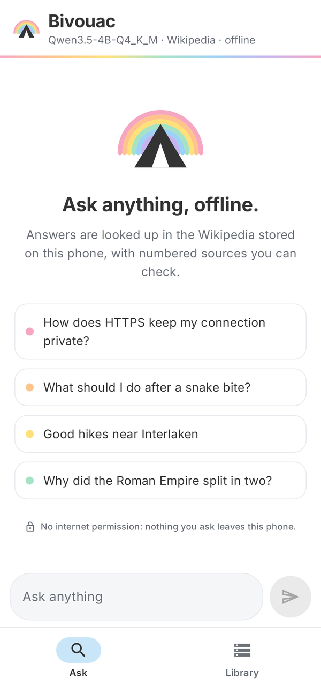
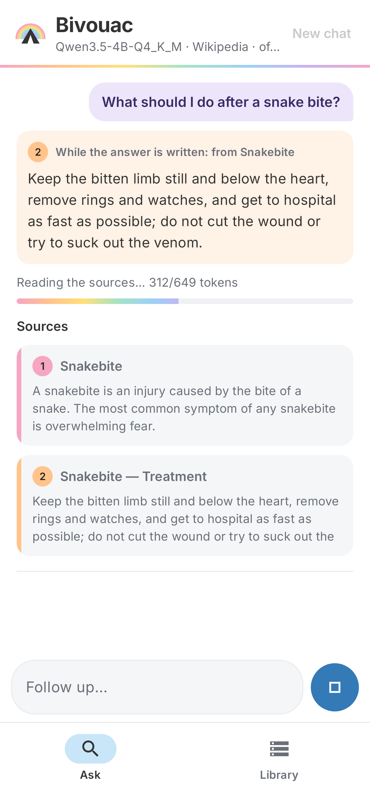
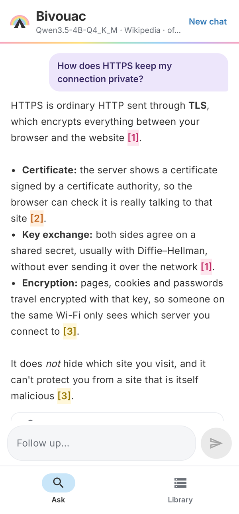
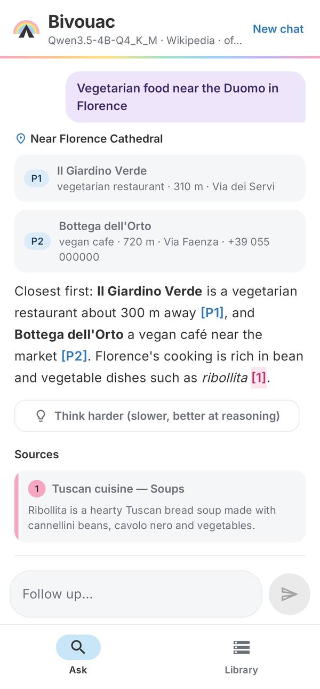
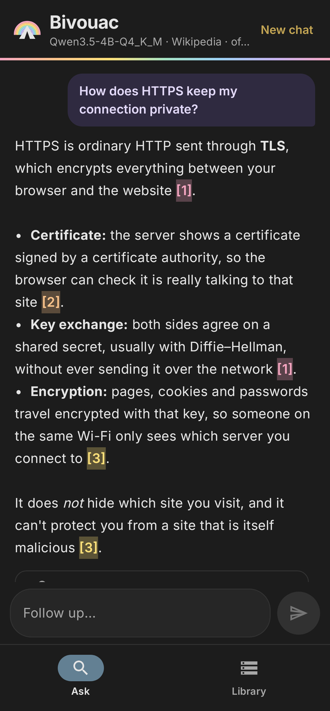

# Bivouac

**An offline research assistant for Android.** Ask a question and get a cited answer from
Wikipedia, or find places near you, with no internet connection, no account and no
Google Play Services. Everything runs on the phone.

Built for [poidh bounty #31](https://poidh.xyz/mainnet/bounty/31): an offline tool that is
more than half as good as a frontier AI with web search, on a phone with at most 12 GB of RAM.

<p align="center">
  
  
  
  
  
</p>
<p align="center"><sub>The app's screens rendered from its code with sample data
(<code>app/src/test/…/ScreenshotTest.kt</code>); light or dark follows the phone.</sub></p>

> Status: work in progress. Numbers marked *TBD* are not measured on a phone yet (the 12 GB tier).

## What it does

- **Cited answers from all of English Wikipedia.** 6.49 M articles (2025-08) in an 18.3 GB
  pack: full text for the 2 M most-read articles, intro and infobox for the rest. Every
  answer is written from numbered excerpts and cites them, like `[1][3]`. Each source has its
  own color, and its markers in the answer are highlighted in the same color, so you can see
  at a glance which sentence rests on which excerpt; tap a source to read the whole excerpt.
- **Places, including "near me".** 30 M places worldwide (Overture Maps, 5.3 GB):
  "vegetarian restaurants near the Duomo in Florence", "pharmacy near Shinjuku Station",
  "ATM near me". Distances come from the phone's GPS or from Wikipedia coordinates, and
  English names work for places the map stores in the local language (Florence → Firenze,
  Moscow → Москва).
- **What's around a place.** "Best hikes near Interlaken", "temples near Siem Reap", "day trips
  from Lisbon": Wikipedia articles located near the place (1.2 M articles with coordinates, in a
  spatial index) become sources, each labelled with its distance and direction ("51 km west of
  Edinburgh"), so the answer names real places at real distances instead of guessing. Castles,
  lakes, temples and towns rank above events, companies and racetracks, and a day-trip list
  names each destination once (Florence: Pisa, San Gimignano, Siena, Lucca, Volterra). A city's
  "Main sights" list is used when it has one.
- **Something useful while it thinks.** An 8 GB phone reads the excerpts for 30–45 s before
  the first word. Meanwhile the app shows the one source sentence that best answers the
  question (for "what should I do" questions, the treatment section), in that source's color.
- **Fast on ordinary phones.** The target is 8 GB phones, not just flagships. The app reads the
  model's header and the phone's RAM before loading, then picks the context length and weight
  layout that fit. On an 8 GB phone it repacks the weights into a CPU-friendly layout, which
  doubles prompt reading (6.5 → 13.4 tokens/s on a Redmi Note 15 Pro) for 0.8 GB more RAM. If
  Android ever kills it for memory, the next load uses smaller settings.
- **Conversations.** Follow-up questions ("and its population?") keep the topic; personal or
  casual messages get a normal reply instead of a Wikipedia search.
- **Think harder.** One tap asks the last question again with the model reasoning first
  (hidden, up to 1,024 tokens). On the reasoning questions of the eval it lifts the 4B from
  4.2 to 8.7 out of 10 and the 9B from 3.5 to 8.8, for a few minutes more per answer. Over all
  question types it is no better (the answers get shorter) and about 5× slower, so it turns
  on by itself only for calculations ("23 km with a 900 m climb, how long?"), where it gained
  or tied in all 9 graded cases, including held-out questions. It starts by itself only on
  phones that write at least 6 tokens/s (on a mid-range 8 GB phone a thought-through answer
  takes several minutes, so there it stays a button).
- **Private by construction.** The app has no INTERNET permission. Downloads go through the
  phone's browser; the app only reads the files you add.

## Install (no PC needed)

1. Install the APK (*TBD: release link*).
2. Open **Library → Download** for a model and the packs. Your browser saves them to Downloads.
3. Tap **Add downloaded files** and allow "All files access" when asked. Bivouac uses the files
   where the browser saved them, without copying (no second 25 GB). It needs that permission
   because llama.cpp and SQLite open files by path; the app has no internet permission, so
   nothing it reads can leave the phone. Tested on the Redmi Note 15 Pro (Android 16).

Which model to pick:

| Phone RAM | Model | File | Quality (% of frontier + web, held-out questions) | Speed on phone (Redmi Note 15 Pro, 8 GB) |
|---|---|---|---|---|
| 4 GB | Qwen3.5-2B Q4_K_M | 1.3 GB | 44 % | 20 tok/s reading, 6 tok/s writing |
| 6 GB | Qwen3.5-4B Q3_K_M | 2.3 GB | slightly below the 4B Q4_K_M¹ | 6 tok/s reading, 2.8 tok/s writing |
| 8 GB | Qwen3.5-4B Q4_K_M | 2.7 GB | **66 %** (PC harness, current build); 54 % on the phone with the 2026-10-07 build | in the app: 12.7 tok/s reading, 3.2 tok/s writing; first words after 35 s, whole answer 93 s (medians, 40 questions) |
| 12 GB | Qwen3.5-9B Q4_K_M | 5.7 GB | 62 % (PC harness; head-to-head with the 4B: a tie, see below) | not measured: no 12 GB test phone |

¹ Graded head-to-head against the 4B Q4_K_M: −0.38 points out of 10 (95 % CI −0.80 to +0.03).
The 8 GB row is the app itself on the phone; the other speeds are llama-bench on the phone's CPU,
and a warm phone under load runs slower (the clocks drop).

Storage: model + Wikipedia pack + places pack = about 25–30 GB, under the bounty's 50 GB limit.

## How it works

1. **Route:** is this a research question, a place search, or conversation?
2. **Retrieve:** full-text search over 34 M Wikipedia sections (SQLite FTS5 with a BM25
   ranker that works on a compact index, blended with article popularity from pageviews).
   Articles named in the question lead with their intro: exact titles, 2.3 M alternative names
   from Wikipedia redirects ("GPS", "WW2"), 40 k acronyms mined from article intros for the ones
   Wikipedia only has as disambiguation pages ("TCP", "BMI"; the question picks the meaning), and
   list articles for list questions, read as their most viewed entries ("must-see museums in
   Berlin" → Pergamon Museum, …) or in rank order ("tallest buildings in Dubai"). Albums,
   songs and films that merely share the question's words are left out unless the question is
   about one ("why does ice float" is not about the jazz album *Floating Ice*).
3. **Compress:** each source is cut down to the sentences that match the question.
4. **Answer:** llama.cpp on the phone's CPU. The fixed instructions are evaluated once and
   reused from a cache, so only the question and excerpts are read each time.

Place searches parse the kind of place and the location, geocode it (Wikipedia coordinates
for 1.2 M articles, from the geo_tags dump, then town centroids), and pass the nearest matches with distances to the model.
When the "place" isn't on the map ("the deepest lake in the world"), the question goes to
Wikipedia instead.
"Near X" and "day trips from X" questions also get the most viewed Wikipedia articles within
20 km (day trips: 15–80 km) of X, from an R-tree over those coordinates.

## Evaluation

60 questions across facts, explanations, comparisons, synthesis, reasoning, travel, health,
tech, science, history and places (`eval/questions.jsonl`), plus 40 held-out questions that were
never used for tuning (`eval/questions-holdout.jsonl`). Each Bivouac answer is compared
blind with an answer from a frontier model using live web search, scored 1–10 for correctness,
completeness and usefulness. Details and how to reproduce: [docs/EVAL.md](docs/EVAL.md).

PC harness (same pipeline and prompt as the app, llama.cpp on a desktop CPU), as % of the
frontier + web answers' score:

| Model | Held-out, 2026-10-19 build ("be concise" prompt) | Held-out, 2026-10-02 build | Main set (60 questions, 2026-10-02 build) |
|---|---|---|---|
| Qwen3.5-9B Q4_K_M | **62.0 %** | 62.7 % | 60.7 % |
| Qwen3.5-4B Q4_K_M | **66.5 %** | 54.0 % | 60.2 % |
| Qwen3.5-2B Q4_K_M | 44.5 % | 45.2 % | 40.7 % |

The 4B and the 9B clear the bounty's 50 % bar on questions that were never used for tuning;
the 2B, for 4 GB phones, does not. A single run varies by about ±3 points (grader noise), so
choices are made head-to-head in one blind packet instead (`tools/grade.py pair`). Graded that
way, the 4B and the 9B are a tie on the held-out set (9B −0.28 points out of 10, 95 % CI −1.13
to +0.58): the 9B gets more facts right (Lake Baikal's depth, which Thai coast gets which
monsoon), the 4B writes fuller answers. Since 2026-10-02 the build fixed questions that were
answered without any sources: "what first aid should I give?" and "when should I see a doctor?"
were taken for personal chat, and "the deepest lake in the world" or "RAM and storage in a phone"
for map searches. That and the retrieval changes are most of the 4B's gain.

**Prompt change (2026-10-19, current build): "be thorough but focused" instead of "be concise".**
Graded head-to-head against the build above on the held-out set: 4B +0.75 points out of 10 (95 % CI
+0.24 to +1.26, better on 27 questions, worse on 6), 9B +0.80 (CI +0.34 to +1.26, 24 vs 4), 2B +0.33
(CI −0.27 to +0.92, 22 vs 16). A second grader model on the 4B pair agreed (+0.55, 22 vs 8). It first
won on the main set (4B +0.62, 9B +0.65). Answers are about 50 % longer (4B: 750 → 1,130 characters,
220 → 300 tokens); on a phone that is roughly 25–30 s more per answer. Absolute scores against the
frontier answers move with the grader: the same old 4B answers scored 57.0 % to 66.5 % across three
grades, and the new build 60.4 % and 60.9 %, so the paired result is the one to go by. Packets and
grades: `eval/grading/pair-pc-*-v29-holdout--pc-*-v32-holdout-thorough.*`, `eval/grading/pc-*-v32-holdout-thorough.*`.

The eval harness sends every question with prompt caching off: with the server reusing the
previous prompt's prefix, the same seeded question gave different answers depending on the
question before it. Current-build answers, packets and grades: `eval/results-pc-*-v29-holdout.jsonl`,
`eval/grading/pc-*-v29-holdout.*`.

- **12 GB model:** Gemma-4-12B (QAT) scored 1.73 points out of 10 below the 9B (95 % CI −2.43 to
  −1.04) and needs more RAM; the 9B at Q5 instead of Q4 was no better (+0.02, CI −0.31 to +0.34)
  and 15 % slower.
- **Screened out earlier** (main set, older pipeline): LFM2.5-8B-A1B 46 %, Gemma-4-E4B 44 %, both
  below the Qwen3.5-4B of the same run (55 %).

**On the phone** (2026-10-07 build, before the fixes above; to be re-run with the current build):
the 4B in the app on a Redmi Note 15 Pro (8 GB, MediaTek MT6789), release
build (no INTERNET permission), the 40 held-out questions: **53.9 %** of the frontier + web score, the
same as the PC harness of that time (54.0 %), so the phone loses nothing. Median 93 s per answer (first words
after 35 s, search 3.7 s), longest 136 s; the app used 3.9 GB of RAM and never got killed.
Answers, packet and grades: `eval/results-redmi-qwen3.5-4b-holdout.jsonl`,
`eval/grading/redmi-qwen3.5-4b-holdout.*`. Weakest there: travel (43 %), comparisons (47 %), tech
(49 %); strongest: health (66 %), facts (60 %), history (59 %).

Retrieval finds a correct Wikipedia article in the top 6 for 92 %
of the questions that have one (44/48), and 94 % on the held-out set (34/36).

## Build from source

Requirements: Linux or WSL2, JDK 17, Android SDK + NDK r29, CMake 3.31. See
[docs/DEV_SETUP.md](docs/DEV_SETUP.md).

```bash
git clone --recursive https://github.com/Wolverr/bivouac
cd bivouac
./gradlew assembleDebug          # app/build/outputs/apk/debug/app-debug.apk
```

Rebuilding the data packs (downloads ~20 GB; a few hours on a 16 GB PC, mostly download time):

```bash
tools/setup_dev.sh               # Python venv for the tools
tools/run_data_jobs.sh           # FineWiki + pageviews -> wiki.db, Overture -> places.db
tools/status.sh                  # progress
# (run_data_jobs.sh also adds the alias, acronym and coordinate tables: tools/build_aliases.py,
#  tools/build_acronyms.py, tools/build_coords.py)
```

## Data and licenses

- Wikipedia text: [FineWiki](https://huggingface.co/datasets/HuggingFaceFW/finewiki)
  (English Wikipedia, 2025-08), CC BY-SA 4.0. Pageviews and redirects: Wikimedia dumps.
- Places: [Overture Maps](https://overturemaps.org) places theme (2026-09), CDLA-Permissive-2.0.
- Models: Qwen3.5 (Apache-2.0) as GGUF files.
- Engine: [llama.cpp](https://github.com/ggml-org/llama.cpp) (MIT), SQLite (public domain),
  zstd (BSD).
- Font: [Inter](https://github.com/rsms/inter), SIL Open Font License 1.1
  ([third_party/fonts/Inter-OFL.txt](third_party/fonts/Inter-OFL.txt)).

App code: [MIT](LICENSE). The data packs and models keep their own licenses (above).
